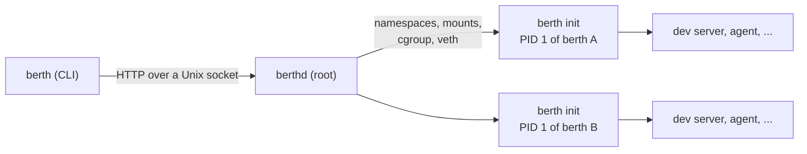

# berth

[](https://github.com/tryensemble/berth/actions/workflows/ci.yml)
[](#license)

**Light, isolated boxes for AI agent threads on one Linux machine.**

berth gives every agent thread a **berth**: its own checkout, processes,
network, ports and limits, walled off from every other berth and from the
machine. The operating system, the tools (git, Node, Claude Code, ...) and the
project's repository are stored once and shared by all of them.

A berth is not a virtual machine. It reserves no memory, boots no kernel and
copies no disk image. It costs what its programs use, as if they ran in a
worktree on the same server. A berth starts in about 30 ms, a command in it
returns in about 4 ms, and 30 idle berths together hold under 20 MB, so one
machine can hold dozens to hundreds of them.

```console
$ berth create --project web --branch fix-login --layer tools
6ae0756e
$ berth exec -d --name dev 6ae0756e -- npm run dev     # :3000 in this berth
$ berth exec -t 6ae0756e -- claude                     # an agent, in the same berth
$ berth forward 6ae0756e 3000                          # http://127.0.0.1:3000 on this machine
```

> [!NOTE]
> berth is young: its walls are tested from the inside (see
> [tests/e2e](tests/e2e)), but it hasn't had an outside security review yet.
> Berths share the machine's kernel; [SECURITY.md](SECURITY.md) says what that
> means.

## Contents

- [Why](#why)
- [What a berth gets](#what-a-berth-gets)
- [Requirements](#requirements)
- [Install](#install)
- [Quick start](#quick-start)
- [Commands](#commands)
- [How it works](#how-it-works)
- [API](#api)
- [Development](#development)
- [Roadmap](#roadmap)
- [License](#license)

## Numbers

On an 8-thread cloud VM, Ubuntu 24.04, berths made from a layer with git and
Node:

| | |
|---|---|
| Create a berth | ~30 ms |
| Run a command in one | ~4 ms (~35 ms under `--strict`, a gVisor sandbox per command) |
| Wake an idle berth | a few ms |
| 30 berths, each running a server | ~28 MB total (~0.9 MB each) |
| 30 berths, idle | ~16 MB total (~0.5 MB each) |
| Snapshot, fork, restore a berth with 540 MB in 2,300 files | 0.16 s, 0.11 s, 0.30 s on XFS, no disk used; 0.24 s, 0.48 s and two full copies on ext4 |

A berth reserves none of this: it costs what its own programs use. Measure
your own with `make e2e` and `berth ls`.

## Why

Running many agents in parallel usually means one virtual machine per thread.
Each one boots its own kernel, reserves gigabytes of memory, and installs the
same tools and dependencies again. Most of that is duplicated, and most of the
time it sits idle.

Worktrees on a shared server avoid the duplication but not the collisions: two
threads can't both serve `:3000`, and one agent can read, break or kill
another's work.

berth keeps the sharing of a single server and adds the walls of separate
machines.

## What a berth gets

| | |
|---|---|
| **Its own processes** | A PID namespace with berth's init as PID 1. It sees nothing of the host or of other berths. |
| **An unprivileged root** | A user namespace of its own: root inside can `apt install`, but outside it's an unused uid range. Agents run as the ordinary user `agent`. |
| **Its own files** | A read-only base image plus shared layers, with a private writable overlay on top. Writes never reach other berths. |
| **Its own checkout** | A clone of the project on its own branch. It shares the objects of a read-only mirror, so a new checkout costs almost nothing. |
| **Its own network** | Its own loopback and ports, and the internet through NAT. The host, other berths, private networks and cloud metadata are blocked. |
| **Limits** | A cgroup per berth for CPU, memory, processes and `/tmp` size, delegated to it: it can arrange its own processes (Docker does) but never raise its limits. |
| **A smaller kernel** | A seccomp filter refuses the kernel's riskiest calls (BPF, io_uring, module loading, the keyring, ...), and `/proc` and `/sys` hide the host. |
| **Rest when unused** | A berth nobody uses is frozen and its memory pushed out: no CPU, about a megabyte. Any use wakes it in milliseconds, with its programs where they were. After a long time unused it's stopped; it starts again in a fraction of a second. |
| **Services** | Commands started with `--service` are kept running and started again whenever the berth starts. |
| **Docker** | Each berth can run its own Docker (its own layer), started on first use. Containers count against the berth's limits, serve on the berth's ports, and no other berth sees them. Pulls go through the tenant's registry mirror. |
| **Snapshots and forks** | A berth's files, services and Docker state at a moment, taken while it's frozen. Restore goes back to one; fork makes a new berth from one. On XFS or btrfs they're reflinks: instant and free until something changes. |
| **Ways in** | Its own SOCKS5 socket where `localhost` is the berth, published host ports, and host ports it may reach (a secrets proxy). |
| **Strict mode** | `--strict` runs the berth's commands under gVisor, a user-space kernel, so a host-kernel bug reachable from inside can't break out. Everything else about the berth is unchanged. |
| **Long-running work** | Everything in a berth is a child of its init, not of the daemon: it keeps running when the daemon restarts or is upgraded. |

## Requirements

- Linux 6.8 or newer, with cgroup v2 (Ubuntu 24.04 is what CI tests on)
- root, for the daemon
- `ip`, `bridge`, `nft`, `iptables`, `nsenter` and `git` on the host
- Rust 1.88+ and `musl-tools` to build

## Install

```sh
git clone https://github.com/tryensemble/berth && cd berth
make                       # a static binary: target/x86_64-unknown-linux-musl/release/berth
sudo make install          # berth, berthd and the systemd unit, plus the berth group
sudo usermod -aG berth "$USER"   # use the CLI without sudo (log in again)
sudo systemctl enable --now berthd
```

## Quick start

```sh
# A base image, pulled straight from a registry (no Docker needed).
berth pull ubuntu:24.04

# A shared layer with git, Node and Claude Code, built once for every berth.
berth layer build tools layers/tools.sh
# And Docker, for berths that run containers (started on first use in a berth).
berth layer build docker layers/docker.sh --from tools
# And gVisor, for strict berths (berth create --strict).
berth layer build gvisor layers/gvisor.sh --from tools

# A project, mirrored once; each berth gets its own branch of it.
berth repo add web https://github.com/you/web

a=$(berth create --project web --branch thread-a --layer tools)
b=$(berth create --project web --branch thread-b --layer tools)

# Both serve :3000. Neither knows about the other.
berth exec --service dev "$a" -- npm run dev
berth exec --service dev "$b" -- npm run dev
berth logs "$a" dev
berth ports "$a"                       # 3000
berth forward "$b" 3000 --local 3001   # b's :3000 at http://127.0.0.1:3001

# Run an agent inside a berth.
berth exec -t -e ANTHROPIC_API_KEY "$a" -- claude

# Unused berths go idle on their own (--idle-after, 5m by default); this does it now.
berth idle "$b"
berth ls                               # b: idle, ~1M of memory
berth ports "$b"; berth exec "$b" -- true   # any use wakes it

berth destroy "$a" "$b"
```

Idle berths' memory goes to swap, so give the machine some. With zswap in
front, it's compressed in memory before it reaches the disk:

```sh
sudo fallocate -l 8G /swapfile && sudo chmod 600 /swapfile
sudo mkswap /swapfile && sudo swapon /swapfile
echo 1 | sudo tee /sys/module/zswap/parameters/enabled
```

## Commands

| Command | What it does |
|---|---|
| `berth create` | Make a berth and print its id (`--name`, `--project`, `--branch`, `--layer`, `--cpus`, `--memory`, `--pids`, `--tmp`, `--idle-after`, `--stop-after`, `--tenant`, `--host-port`, `--strict`) |
| `berth exec ID -- CMD` | Run a command in a berth, waking it if needed (`-t` terminal, `-d` detach, `--service NAME`, `-u` user, `-e` env, `--dir`) |
| `berth logs ID NAME` | What a detached command or service printed (`-f` to follow) |
| `berth service ls\|rm ID` | A berth's services |
| `berth ports ID` | The TCP ports something listens on in a berth |
| `berth proxy ID PORT` | Connect stdin and stdout to a port in a berth, for use as an SSH `ProxyCommand` and the like |
| `berth forward ID PORT` | Serve a berth's port on this machine's `127.0.0.1` |
| `berth socks ID` | The berth's SOCKS5 socket, where `localhost` is the berth (`--listen ADDR` serves it on TCP) |
| `berth publish\|unpublish ID PORT` | Serve a berth's port on a host port (`--host-port`, `--address`), kept across restarts |
| `berth idle\|stop\|start ID...` | Freeze berths, stop them, or start them again |
| `berth trim ID...` | Hand back a running berth's cache without freezing it |
| `berth snapshot create\|ls\|rm ID` | A berth's files and services at a moment |
| `berth restore ID NAME` | Put a berth back as it was in a snapshot |
| `berth fork ID` | A new berth from a berth or one of its snapshots (`--snapshot`, `--branch`, `--name`) |
| `berth ls` | List berths with their state and memory (`--json` for scripts) |
| `berth destroy ID...` | Remove berths and everything in them |
| `berth pull REF` / `berth images` | Pull an OCI image, such as `ubuntu:24.04`, to make berths from |
| `berth layer build\|commit\|ls\|rm` | Keep what a script (or you, by hand) installed in a berth as a shared, read-only layer |
| `berth repo add\|ls\|rm` | Mirror a project's repository, or fetch it again |

Wherever a command takes a berth's id, it takes its name too. Every command talks to the daemon at `/run/berth/berth.sock`. Set
`BERTH_SOCKET` to use another socket.

## How it works



One static binary plays three roles:

- **`berth`**: the command line, a client of the daemon's socket.
- **`berthd`**: the daemon, run as root. It pulls images, builds each berth's
  filesystem, cgroup and network, and serves the API.
- **`berth __init`**: PID 1 inside each berth. It builds the berth's mounts,
  pivots into them, and starts and reaps every command run in the berth.
  Commands are its children, so they don't depend on the daemon.

A berth's root is an overlay: the image and its layers at the bottom, shifted
into the berth's uid range with idmapped mounts, so one copy on disk serves
every berth. Each berth's writes go to its own upper layer on top.
[docs/ARCHITECTURE.md](docs/ARCHITECTURE.md) has the full design and the
reasons behind it.

## API

`berthd` speaks HTTP/1.1 with JSON over its Unix socket. Exec and proxy switch
the connection to a stream with `Upgrade`, as Docker's API does.

| Method | Path | |
|---|---|---|
| `GET` | `/v1/berths` | List berths |
| `POST` | `/v1/berths` | Create a berth |
| `GET` | `/v1/berths/{id}` | One berth |
| `DELETE` | `/v1/berths/{id}` | Destroy a berth |
| `POST` | `/v1/berths/{id}/start`, `/idle`, `/stop`, `/trim` | Change its state |
| `GET`, `POST`, `DELETE` | `/v1/berths/{id}/snapshots[/{name}]` | List, take or remove snapshots |
| `POST` | `/v1/berths/{id}/restore`, `/fork` | Restore a snapshot; fork a new berth |
| `POST`, `DELETE` | `/v1/berths/{id}/publish[/{port}]` | Publish a port on the host, or stop |
| `GET` | `/v1/berths/{id}/ports` | Listening ports |
| `POST` | `/v1/berths/{id}/exec` | Run a command (upgrade; framed stdin, stdout, stderr, exit code) |
| `POST` | `/v1/berths/{id}/proxy` | A byte stream to a port (upgrade) |
| `GET` | `/v1/berths/{id}/services` | Its services |
| `DELETE` | `/v1/berths/{id}/services/{name}` | Stop and forget a service |
| `GET`, `POST` | `/v1/images` | List, or pull, images |
| `GET`, `POST` | `/v1/repos` | List, or mirror, repositories |
| `DELETE` | `/v1/repos/{name}` | Remove a mirror no berth uses |
| `GET`, `POST` | `/v1/layers` | List layers, or keep a berth's changes as one |
| `DELETE` | `/v1/layers/{name}` | Remove a layer no berth uses |

An exec stream is a series of frames: a type byte, a big-endian `u32` length,
then the data (see [`src/api/frames.rs`](src/api/frames.rs)).

## Development

```sh
make test     # unit and CLI tests, no root needed
make lint     # rustfmt and clippy, as CI runs them
make e2e      # end-to-end tests against a running berthd
```

The end-to-end tests drive the real CLI against a running daemon. They make
berths in parallel, check isolation from the inside, and remove everything they
made. They're `#[ignore]`d by default because they need a daemon. `make e2e`
runs them in the `berth` group so they can reach its socket.

```
src/
├── main.rs        the binary: berth, or berthd when called by that name
├── cli.rs         the command line
├── api/           the wire: HTTP over the socket, exec frames, the client
├── daemon/        berthd: routes, berth lifecycle, layers, repos, spawning init, proxying
├── init/          PID 1 of a berth: its root filesystem, reaping, running commands
├── image/         pulling and unpacking OCI images
├── net/           the bridge, veth pairs, nftables rules, listening ports
├── sys/           Linux calls std doesn't wrap: mounts, idmapped mounts, fd passing
└── pipe.rs        joining two byte streams
tests/
├── cli.rs         the binary without a daemon
└── e2e/           the binary against a running daemon: basics, hardening, lifecycle
layers/             shared layers: tools (git, Node, Claude Code), docker, gvisor
dist/              the systemd unit
docs/              architecture, and how Ensemble drives berth
```

See [CONTRIBUTING.md](CONTRIBUTING.md) for how changes are made.

## Roadmap

1. **Prototype** ✅ create, exec (terminal and detached), ports, proxy,
   destroy; images, layers and project checkouts; isolated networking.
2. **Hardening** ✅ seccomp, masked `/proc`, delegated cgroups, link-safe
   setup, Landlock around the daemon's root work. Idle, stop and wake.
   Services.
3. **Docker inside a berth** ✅ its own dockerd, started on first use,
   containers in the berth's cgroup and network, pulls through its tenant's
   registry mirror.
4. **Snapshots and forks** ✅ consistent snapshots, restore and fork, free
   on XFS; SOCKS sockets, published ports, names, host ports and a registry
   mirror per tenant. What an [Ensemble](https://github.com/tryensemble) driver
   needs is all there; [docs/ensemble.md](docs/ensemble.md) maps it.
5. **Strict mode** ✅ `--strict` runs a berth's commands under gVisor; a
   command's syscalls reach the gVisor sentry, not the host kernel, while
   ports, SOCKS, idle/wake and the rest are unchanged.

## License

Licensed under either of [Apache License, Version 2.0](LICENSE-APACHE) or
[MIT license](LICENSE-MIT), at your option. Unless you explicitly state
otherwise, any contribution you submit for inclusion in berth shall be dual
licensed as above, without any additional terms or conditions.
