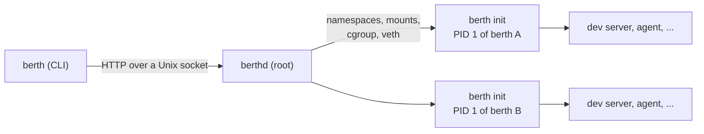

# berth

[](https://github.com/tryensemble/berth/actions/workflows/ci.yml)
[](#license)

**Light, isolated boxes for AI agent threads on one Linux machine.**

berth gives every agent thread a **berth**: its own checkout, processes,
network, ports and limits, walled off from every other berth and from the
machine. The operating system, the tools (git, Node, Claude Code, ...) and the
project's repository are stored once and shared by all of them.

A berth is not a virtual machine. It reserves no memory, boots no kernel and
copies no disk image. It costs what its programs use, as if they ran in a
worktree on the same server. A berth starts in about 40 ms (130 ms with a
checkout of its project), and its init takes under 2 MB of memory, so one
machine can hold dozens to hundreds of them.

```console
$ berth create --project web --branch fix-login --layer tools
6ae0756e
$ berth exec -d --name dev 6ae0756e -- npm run dev     # :3000 in this berth
$ berth exec -t 6ae0756e -- claude                     # an agent, in the same berth
$ berth forward 6ae0756e 3000                          # http://127.0.0.1:3000 on this machine
```

> [!WARNING]
> berth is an early prototype. The core works: namespaces, an
> unprivileged root, overlay filesystems, cgroup limits and an isolated
> network. The hardening that the [architecture](docs/ARCHITECTURE.md) calls
> for (a seccomp allowlist, Landlock) isn't in yet. Don't run untrusted code in
> it on a machine you care about.

## Contents

- [Why](#why)
- [What a berth gets](#what-a-berth-gets)
- [Requirements](#requirements)
- [Install](#install)
- [Quick start](#quick-start)
- [Commands](#commands)
- [How it works](#how-it-works)
- [API](#api)
- [Development](#development)
- [Roadmap](#roadmap)
- [License](#license)

## Why

Running many agents in parallel usually means one virtual machine per thread.
Each one boots its own kernel, reserves gigabytes of memory, and installs the
same tools and dependencies again. Most of that is duplicated, and most of the
time it sits idle.

Worktrees on a shared server avoid the duplication but not the collisions: two
threads can't both serve `:3000`, and one agent can read, break or kill
another's work.

berth keeps the sharing of a single server and adds the walls of separate
machines.

## What a berth gets

| | |
|---|---|
| **Its own processes** | A PID namespace with berth's init as PID 1. It sees nothing of the host or of other berths. |
| **An unprivileged root** | A user namespace of its own: root inside can `apt install`, but outside it's an unused uid range. Agents run as the ordinary user `agent`. |
| **Its own files** | A read-only base image plus shared layers, with a private writable overlay on top. Writes never reach other berths. |
| **Its own checkout** | A clone of the project on its own branch. It shares the objects of a read-only mirror, so a new checkout costs almost nothing. |
| **Its own network** | Its own loopback and ports, and the internet through NAT. The host, other berths, private networks and cloud metadata are blocked. |
| **Limits** | A cgroup per berth for CPU, memory, processes and `/tmp` size. |
| **Long-running work** | Detached commands are children of the berth's init, not of the daemon: they keep running when the daemon restarts. |

## Requirements

- Linux 6.8 or newer, with cgroup v2 (Ubuntu 24.04 is what CI tests on)
- root, for the daemon
- `ip`, `bridge`, `nft`, `iptables`, `nsenter` and `git` on the host
- Rust 1.88+ and `musl-tools` to build

## Install

```sh
git clone https://github.com/tryensemble/berth && cd berth
make                       # a static binary: target/x86_64-unknown-linux-musl/release/berth
sudo make install          # berth, berthd and the systemd unit, plus the berth group
sudo usermod -aG berth "$USER"   # use the CLI without sudo (log in again)
sudo systemctl enable --now berthd
```

## Quick start

```sh
# A base image, pulled straight from a registry (no Docker needed).
berth pull ubuntu:24.04

# A shared layer with git, Node and Claude Code, built once for every berth.
berth layer tools layers/tools.sh

# A project, mirrored once; each berth gets its own branch of it.
berth repo web https://github.com/you/web

a=$(berth create --project web --branch thread-a --layer tools)
b=$(berth create --project web --branch thread-b --layer tools)

# Both serve :3000. Neither knows about the other.
berth exec -d --name dev "$a" -- npm run dev
berth exec -d --name dev "$b" -- npm run dev
berth ports "$a"                       # 3000
berth forward "$b" 3000 --local 3001   # b's :3000 at http://127.0.0.1:3001

# Run an agent inside a berth.
berth exec -t -e ANTHROPIC_API_KEY "$a" -- claude

berth destroy "$a" "$b"
```

## Commands

| Command | What it does |
|---|---|
| `berth pull REF` | Pull an OCI image, such as `ubuntu:24.04`, to make berths from |
| `berth layer NAME SCRIPT` | Run a script as root in a fresh berth and keep what it installed as a shared, read-only layer |
| `berth repo NAME URL` | Mirror a project's repository, or fetch it again |
| `berth create` | Make a berth and print its id (`--project`, `--branch`, `--layer`, `--cpus`, `--memory`, `--pids`, `--tmp`) |
| `berth exec ID -- CMD` | Run a command in a berth (`-t` terminal, `-d` detach, `-u` user, `-e` env, `-w` dir) |
| `berth ports ID` | List the TCP ports something listens on in a berth |
| `berth proxy ID PORT` | Connect stdin and stdout to a port in a berth, for use as an SSH `ProxyCommand` and the like |
| `berth forward ID PORT` | Serve a berth's port on this machine's `127.0.0.1` |
| `berth ls` | List berths (`--json` for scripts) |
| `berth destroy ID...` | Remove berths and everything in them |

Every command talks to the daemon at `/run/berth/berth.sock`. Set
`BERTH_SOCKET` to use another socket.

## How it works



One static binary plays three roles:

- **`berth`**: the command line, a client of the daemon's socket.
- **`berthd`**: the daemon, run as root. It pulls images, builds each berth's
  filesystem, cgroup and network, and serves the API.
- **`berth __init`**: PID 1 inside each berth. It builds the berth's mounts,
  pivots into them, and starts and reaps every command run in the berth.
  Commands are its children, so they don't depend on the daemon.

A berth's root is an overlay: the image and its layers at the bottom, shifted
into the berth's uid range with idmapped mounts, so one copy on disk serves
every berth. Each berth's writes go to its own upper layer on top.
[docs/ARCHITECTURE.md](docs/ARCHITECTURE.md) has the full design and the
reasons behind it.

## API

`berthd` speaks HTTP/1.1 with JSON over its Unix socket. Exec and proxy switch
the connection to a stream with `Upgrade`, as Docker's API does.

| Method | Path | |
|---|---|---|
| `GET` | `/v1/berths` | List berths |
| `POST` | `/v1/berths` | Create a berth |
| `GET` | `/v1/berths/{id}` | One berth |
| `DELETE` | `/v1/berths/{id}` | Destroy a berth |
| `GET` | `/v1/berths/{id}/ports` | Listening ports |
| `POST` | `/v1/berths/{id}/exec` | Run a command (upgrade; framed stdin, stdout, stderr, exit code) |
| `POST` | `/v1/berths/{id}/proxy` | A byte stream to a port (upgrade) |
| `POST` | `/v1/images` | Pull an image |
| `POST` | `/v1/repos` | Mirror a repository |
| `POST` | `/v1/layers` | Keep a berth's changes as a layer |

An exec stream is a series of frames: a type byte, a big-endian `u32` length,
then the data (see [`src/api/frames.rs`](src/api/frames.rs)).

## Development

```sh
make test     # unit and CLI tests, no root needed
make lint     # rustfmt and clippy, as CI runs them
make e2e      # end-to-end tests against a running berthd
```

The end-to-end tests drive the real CLI against a running daemon. They make
berths in parallel, check isolation from the inside, and remove everything they
made. They're `#[ignore]`d by default because they need a daemon. `make e2e`
runs them in the `berth` group so they can reach its socket.

```
src/
├── main.rs        the binary: berth, or berthd when called by that name
├── cli.rs         the command line
├── api/           the wire: HTTP over the socket, exec frames, the client
├── daemon/        berthd: routes, berth lifecycle, layers, repos, spawning init, proxying
├── init/          PID 1 of a berth: its root filesystem, reaping, running commands
├── image/         pulling and unpacking OCI images
├── net/           the bridge, veth pairs, nftables rules, listening ports
├── sys/           Linux calls std doesn't wrap: mounts, idmapped mounts, fd passing
└── pipe.rs        joining two byte streams
tests/
├── cli.rs         the binary without a daemon
└── e2e.rs         the binary against a running daemon
layers/tools.sh    the tools layer: git, Node, Claude Code, the agent user
dist/              the systemd unit
docs/              architecture
```

See [CONTRIBUTING.md](CONTRIBUTING.md) for how changes are made.

## Roadmap

1. **Prototype** ✅ create, exec (terminal and detached), ports, proxy,
   destroy; images, layers and project checkouts; isolated networking.
2. Hardening: a seccomp allowlist and Landlock. Idle, stop and wake.
   Services that restart when a berth wakes.
3. Docker inside a berth, a registry mirror, shared caches, reflinked
   checkouts.
4. Snapshots and forks, and an [Ensemble](https://github.com/tryensemble)
   driver.
5. Strict mode: berths under gVisor, for code nobody vouches for.

## License

Licensed under either of [Apache License, Version 2.0](LICENSE-APACHE) or
[MIT license](LICENSE-MIT), at your option. Unless you explicitly state
otherwise, any contribution you submit for inclusion in berth shall be dual
licensed as above, without any additional terms or conditions.
